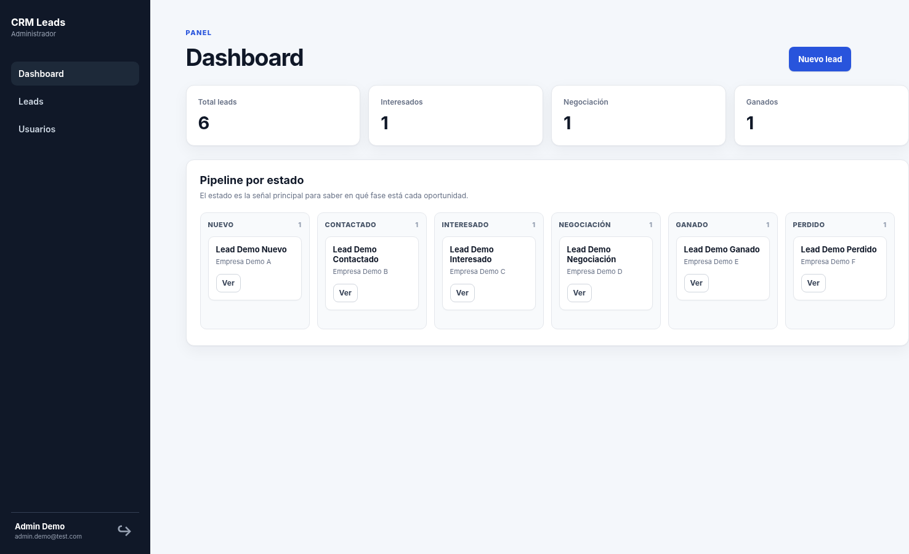
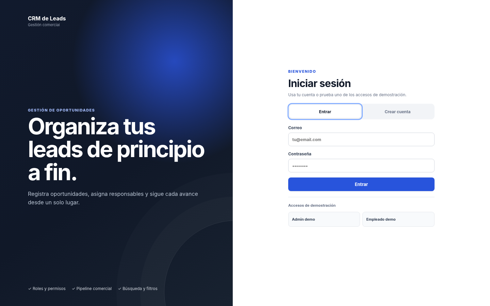
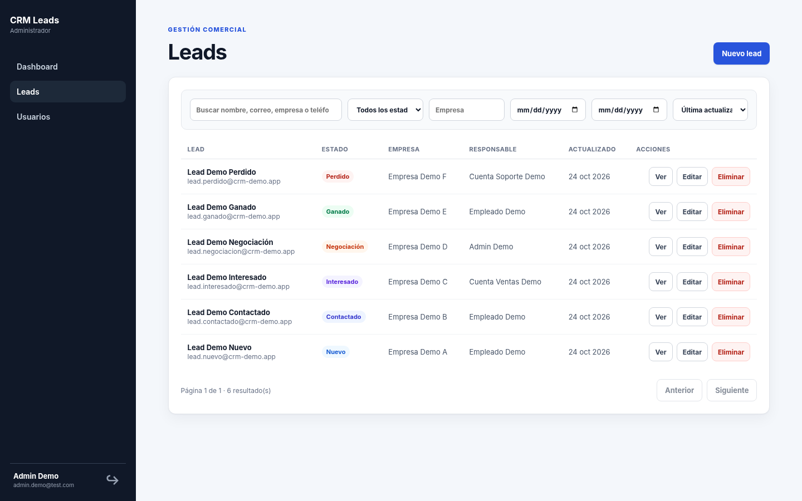
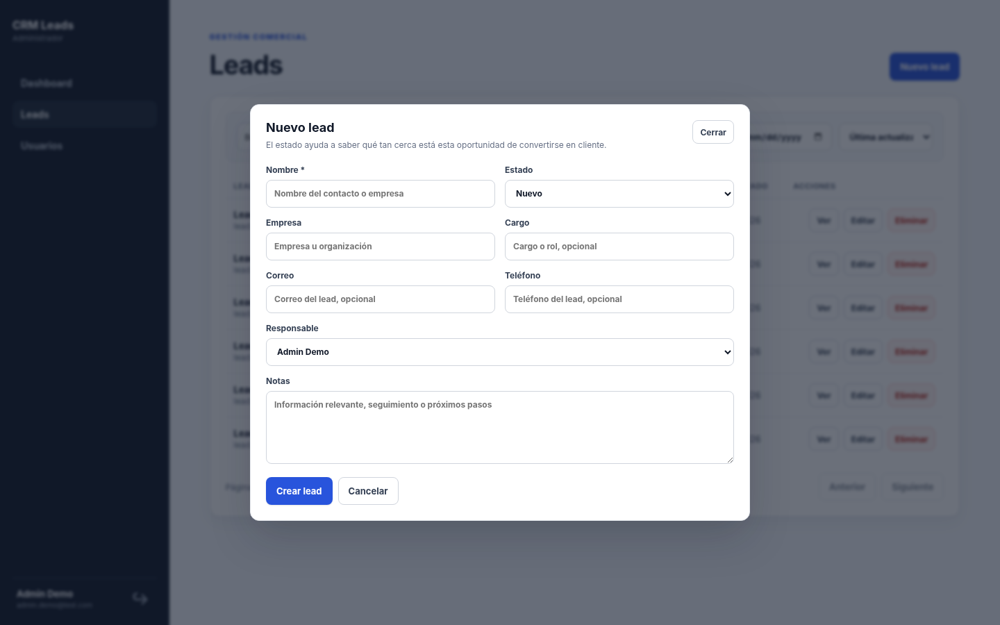
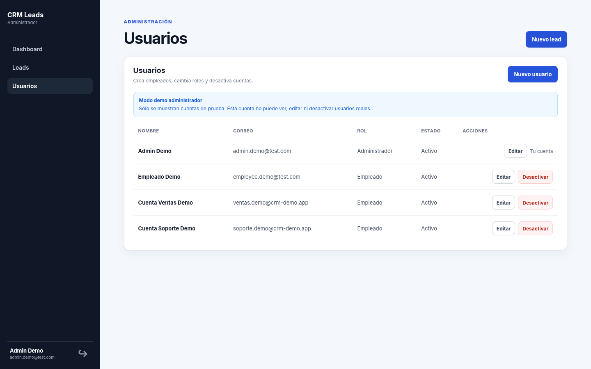

# CRM de Leads

CRM web para registrar oportunidades comerciales, asignar responsables y seguir el avance de cada lead. Incluye una interfaz en JavaScript y una API REST construida con FastAPI, PostgreSQL y SQLAlchemy.

La aplicación está desplegada en Render y cuenta con accesos de demostración para probar sus dos roles sin registrarse.

[Aplicación web](https://crm-backend-kpcb.onrender.com/) · [Documentación de la API](https://crm-backend-kpcb.onrender.com/docs) · [Integración continua](https://github.com/bastianc-dev/crm-backend/actions)



## Probar la aplicación

1. Abre la [demo pública](https://crm-backend-kpcb.onrender.com/).
2. Selecciona `Admin demo` o `Empleado demo` en la pantalla de acceso.
3. Revisa el dashboard, consulta los leads y prueba los filtros, la edición y los permisos de cada rol.

El administrador puede gestionar usuarios y consultar los leads de su ámbito de acceso. El empleado solo puede gestionar los leads asignados a su cuenta. En la demo, las acciones del administrador están limitadas a usuarios y leads de prueba; no puede acceder a datos reales de otras cuentas.

Al iniciar una nueva sesión de demostración se restablecen los leads de prueba. Los cambios realizados durante una sesión pueden desaparecer si otro visitante vuelve a entrar en modo demo. En una instalación propia, esta característica se controla con `DEMO_MODE`.

## Funcionalidades

- Registro e inicio de sesión, access tokens JWT y refresh tokens.
- Gestión de usuarios con roles `admin` y `employee`.
- Creación, consulta, edición y eliminación de leads con control de permisos.
- Asignación de leads a empleados y seguimiento por estado.
- Dashboard con indicadores y pipeline comercial.
- Búsqueda, filtros por estado, empresa y fechas, ordenamiento y paginación.
- Validación de datos y manejo de errores en la API.
- Migraciones de base de datos, tests automatizados y ejecución con Docker.

Los estados disponibles son Nuevo, Contactado, Interesado, Negociación, Ganado y Perdido.

## Capturas

| Acceso | Gestión de leads |
| --- | --- |
|  |  |

| Formulario de lead | Administración de usuarios |
| --- | --- |
|  |  |

Las capturas corresponden al frontend de este repositorio ejecutado localmente con los datos de demostración incluidos en el backend. También hay una [vista móvil del acceso](docs/images/mobile-login.png). Para regenerarlas desde una instancia pública, consulta [Capturar la interfaz](#capturar-la-interfaz).

## Tecnologías y estructura

- Backend: Python 3.12, FastAPI, SQLAlchemy 2, Pydantic y JWT.
- Base de datos: PostgreSQL 16 y Alembic.
- Frontend: HTML, CSS y JavaScript, servido desde la misma aplicación FastAPI.
- Desarrollo y pruebas: Docker Compose, Pytest, HTTPX y GitHub Actions.

La lógica está organizada en rutas HTTP (`app/routers`), servicios (`app/services`), repositorios (`app/repositories`), modelos de base de datos (`app/models`) y esquemas de validación (`app/schemas`). El frontend se encuentra en `app/static` y los tests en `app/tests`.

```text
app/
├── auth/           # Autenticación y autorización
├── core/           # Configuración y utilidades
├── models/         # Tablas y relaciones
├── repositories/   # Acceso a datos
├── routers/        # Endpoints HTTP
├── schemas/        # Entrada y salida de la API
├── services/       # Reglas de negocio
├── static/         # Interfaz web
└── tests/          # Pruebas automatizadas
alembic/            # Migraciones
scripts/            # Configuración inicial y utilidades
docs/images/         # Capturas de la interfaz
```

## Ejecutar localmente con Docker

Se necesita Docker con Compose. Los comandos se ejecutan desde la raíz del repositorio.

```bash
git clone https://github.com/bastianc-dev/crm-backend.git
cd crm-backend
cp .env.example .env
```

Antes de iniciar los servicios, reemplaza `SECRET_KEY` y `POSTGRES_PASSWORD` en `.env` por valores propios. Una clave puede generarse con:

```bash
python -c "import secrets; print(secrets.token_urlsafe(32))"
```

Si se cambia `POSTGRES_PASSWORD`, también deben actualizarse las credenciales de `DATABASE_URL` y `TEST_DATABASE_URL` en `.env`. El archivo es para desarrollo local y no debe subirse al repositorio.

```bash
docker compose up -d --build
```

La aplicación estará en `http://localhost:8000`, Swagger en `http://localhost:8000/docs` y el endpoint de salud en `http://localhost:8000/api/health`. Las migraciones se aplican automáticamente al iniciar el servicio `api`.

Para detener los servicios usa `docker compose down`. El comando `docker compose down -v` también elimina los datos de la base de datos local.

### Usuario administrador inicial

El registro público crea cuentas de empleado. Para preparar el primer administrador, configura `FIRST_ADMIN_NAME`, `FIRST_ADMIN_EMAIL` y `FIRST_ADMIN_PASSWORD` en `.env` y ejecuta:

```bash
docker compose exec api python scripts/create_admin.py
```

Para habilitar accesos demo en una instalación local, configura `DEMO_MODE=true` y reinicia el servicio. No se recomienda habilitarlo en una instalación que maneje datos reales.

## Ejecución sin Docker para la API

Se necesita Python 3.12 y PostgreSQL. Copia `.env.example` a `.env`, crea la base de datos indicada en `POSTGRES_DB` y asegúrate de que `DATABASE_URL` apunte al PostgreSQL local.

```bash
python -m venv .venv
source .venv/bin/activate           # En Windows: .venv\Scripts\activate
pip install -r requirements.txt
alembic upgrade head
uvicorn app.main:app --reload
```

En este modo puede utilizarse `docker compose up -d postgres` para levantar solo la base de datos. El archivo `.env.example` configura PostgreSQL en `localhost:5433`.

## Tests

Los tests usan una base PostgreSQL independiente porque las fixtures crean y eliminan tablas. Con los contenedores levantados:

```bash
docker compose exec api python scripts/prepare_test_db.py
docker compose exec api pytest -q --cov=app --cov-report=term-missing
```

`prepare_test_db.py` crea la base de pruebas si todavía no existe, incluso cuando el volumen de PostgreSQL ya estaba inicializado. Comprueba que su nombre sea distinto al de la base principal. El workflow de GitHub Actions ejecuta migraciones, verifica su consistencia y corre las pruebas contra PostgreSQL en cada push a `main` y en las pull requests.

## API

La documentación interactiva disponible en `/docs` muestra parámetros, esquemas y respuestas de cada endpoint. Estas son las rutas principales:

| Método | Ruta | Uso |
| --- | --- | --- |
| `POST` | `/register` | Registrar un empleado |
| `POST` | `/login` | Iniciar sesión |
| `POST` | `/refresh` | Renovar el access token |
| `GET` | `/me` | Obtener el usuario autenticado |
| `GET` | `/dashboard/stats` | Consultar indicadores |
| `GET`, `POST` | `/leads` | Listar y crear leads |
| `GET`, `PATCH`, `DELETE` | `/leads/{lead_id}` | Consultar, modificar y eliminar un lead |
| `GET`, `POST` | `/users` | Listar y crear usuarios (admin) |
| `GET`, `PATCH`, `DELETE` | `/users/{user_id}` | Gestionar usuarios (admin) |
| `POST` | `/demo/login/admin` | Iniciar la demo como administrador |
| `POST` | `/demo/login/employee` | Iniciar la demo como empleado |
| `GET` | `/api/health` | Verificar el servicio |

Las rutas protegidas requieren un token `Bearer` obtenido mediante `/login` o uno de los accesos demo.

## Capturar la interfaz

Las imágenes del README pueden actualizarse mediante Playwright. Con el frontend accesible y `DEMO_MODE=true`:

```bash
pip install playwright
playwright install chromium
python scripts/capture_screenshots.py --url https://crm-backend-kpcb.onrender.com/
```

El script guarda las imágenes en `docs/images` y usa los botones de demostración para entrar. No utiliza credenciales personales. Para trabajar contra la instalación local, omite `--url`. Evita ejecutarlo contra una base de datos de producción con información real: el ingreso demo restablece los leads de prueba.

## Configuración para despliegue

La aplicación lee su configuración desde variables de entorno. `DATABASE_URL` y `SECRET_KEY` son obligatorias. El contenedor ejecuta las migraciones antes de iniciar Uvicorn y escucha el puerto indicado por `PORT` o, por defecto, el `8000`.

El archivo `.env.example` contiene todas las variables utilizadas en desarrollo. En un despliegue, configura los secretos en el proveedor de hosting y no subas `.env`. `DEMO_MODE=false` desactiva los accesos de demostración.
